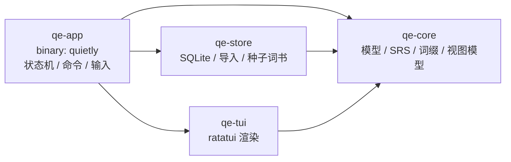

# quietly

> 一个伪装成命令行 agent 的英语学习 TUI。Rust + ratatui + SQLite，本地离线可用。

```
quietly  CET-4 核心词                          due 8 · new 4/20 · streak 3
⏺ ready  CET-4 核心词
  ⎿  40 词 · 已学 12 · 待复习 8
     输入单词查询 · /study 开始 · /help 命令

› inspect

⏺ word  lookup
  ⎿  inspect  /ɪnˈspekt/
       v. 检查；视察
       词根
       ◂ in-         前缀 向内
       ◆ spect       词根 看
       ↳ 向内 + 看
       例句
       ▸ Engineers inspect the bridge every year.
         工程师每年检查这座桥。

› /study

⏺ study  CET-4 核心词
  ⎿  8 新词 · 8 复习
     今日新词 4/20 · 1-4 评分 · esc 退出

⏺ word  review · 1/16
  ⎿  consistent  /kənˈsɪstənt/
     回忆词义后按 space 揭晓 · tab 给提示

› 3

⏺ rated  认识
  ⎿  consistent · next 4d · interval 4d · ease 2.50
```

界面刻意做成命令式 agent 的对话流：没有大边框、没有进度条面板，窗口标题可以随便改，
放在编辑器旁边看起来就像在跑一个 CLI 工具。

## 功能（单词模块）

- **词书**：从 ECDICT、JSON、CSV、TXT 导入任意词书，不做内置示例（空的库从你自己的词书开始）
- **词根分解**：只认 Wiktionary 词源模板、词典条目或自备词根表，每段都带 `source`；
  没有数据的词就不显示词根区块，**不推测、不生成**
- **词组搭配**：从词典的 `相关词组:` 段抽取，或用 `quietly phrases` / `/phrase` 自己补
- **例句**：每词最多 3 条例句（中英对照），可用 Tatoeba 等语料批量合并
- **多义词**：按词性分行，带 `[医]` `[古]` 等标签的生僻义单独归组
- **记忆曲线**：Anki 风格的学习步骤 + SM-2 难度因子，1/2/3/4 四档评价
- **复习**：按到期时间排队，新词与复习交替出现，每日新词上限可调
- **每日总结**：新学/复习/评价分布/专注时长/连续天数，未来 7 天复习压力

## 快速开始

```bash
cargo run --release          # 进入 TUI
cargo run --release -- books # 查看词书
```

> Windows 上需要可用的链接器与 C 编译器：GNU 工具链配 [MinGW-w64](https://www.mingw-w64.org/)
> （`gcc` 在 PATH 里），或 MSVC 工具链配 Visual Studio Build Tools。`rusqlite` 的 `bundled`
> 特性会用 C 编译 SQLite，所以两者缺一不可。macOS / Linux 装好 `build-essential` / `xcode-select` 即可。
> 详细步骤与下载地址见 [docs/windows-setup.md](docs/windows-setup.md)。

数据分两个 SQLite 文件，放在这些位置：

- Windows：`%APPDATA%\quietly-english\`
- macOS / Linux：`~/.local/share/quietly-english/`
- 覆盖：设置环境变量 `QUIETLY_HOME` 或 `--db <path>`

| 文件 | 内容 | 体积 |
| --- | --- | --- |
| `quietly.db` | 词书、卡片、复习流水、阅读、设置 | 几 MB（可进 git） |
| `quietly-words.db` | 词典（327 万词条） | 500 MB+（可重建） |

`quietly db` 查看两个文件的实际位置与大小。**换机器时只需要搬 `quietly.db`**，
词典那半边用下载包重建即可。词书、卡片、复习流水都以 `lemma` 引用词条，
所以随手换一份词典也不会让进度错位；`quietly doctor` 核对引用是否完整
（`--fix` 清掉词典里已经不存在的词）。

### 导入正式词库

```bash
quietly import CET6_T.json                      # qwerty-learner 词书，免转换
quietly dict stardict-ecdict-2.4.2.ifo          # ECDICT StarDict 词典（327 万词条）
quietly dict stardict-langdao-ec-gb.ifo --merge # 再叠一本，只追加新义项不覆盖
quietly etymology kaikki.org-dictionary-English.jsonl   # Wiktionary 词源（有出处）
quietly examples cmn_sentences.tsv eng_sentences.tsv links.csv  # Tatoeba 中英例句
```

| 数据 | 作用 | 来源 |
| --- | --- | --- |
| 词书 JSON | 考试大纲词汇，按文件名自动归入 `cet4`/`cet6`/`ky`/`toefl`/`ielts`/`gre` | [qwerty-learner](https://github.com/RealKai42/qwerty-learner)（MIT） |
| StarDict | 查词覆盖，含音标与中英释义；`--merge` 叠朗道可补 7.5% 的生僻义与搭配 | [ECDICT](https://github.com/skywind3000/ECDICT)（MIT）· [huzheng](http://download.huzheng.org/zh_CN/) |
| 词源 JSONL | 词根分解 + 出处，卡片显示 `source:` | [kaikki.org](https://kaikki.org/dictionary/English/)（CC BY-SA） |
| 例句 TSV | 中英对照例句，每词最多 3 条 | [Tatoeba](https://tatoeba.org/en/downloads)（CC-BY 2.0 FR） |

**词根不靠算法猜**：只从 Wiktionary 词源模板或自备词根表读取，没有数据的词就不显示词根区块。
**搭配也不靠统计猜**：只从词典里显式标出的 `相关词组:` 段或自备 TSV 读取。
详细下载地址、体积和字段说明见 [docs/data-sources.md](docs/data-sources.md)。

### 数据包

输入数据统一放在仓库的 [`packs/`](packs/README.md) 下，按「小则提交、大则重下」分开：

| 目录 | 内容 | 进 git |
| --- | --- | --- |
| `packs/decks/` | 词书 JSON / CSV / TXT | ✅ |
| `packs/texts/` | 阅读文本（可双语） | ✅ |
| `packs/quizzes/` | 阅读题目 TSV | ✅ |
| `packs/dict/` · `packs/etymology/` · `packs/examples/` | 词典、词源、例句语料 | ❌ 重新下载 |

所以 clone 下来就能读到 `packs/texts/` 里的文章、做 `packs/quizzes/` 里的题，
但词库要自己下——词典动辄几百 MB，而且多数商业词典的电子版版权状态不明，不适合进仓库。

### 其他格式

```bash
quietly import words.json     # {"name":"我的词书","words":[{...}]}
quietly import words.csv      # word,translation,phonetic,roots,example,example_zh
quietly import examples.csv   # word,sentence,translation —— 只合并例句
quietly import list.txt       # 一行一词，释义从已导入的词典里补
quietly phrases words.tsv     # lemma,phrase,gloss —— 补常用词组/固定搭配
quietly phrase "bank bank on = 指望"   # 单条补录搭配
quietly etymology roots.tsv   # lemma/part/gloss/kind/source 五列，自备词根表
quietly word inspect          # 不走 TUI，直接看一个词条
```

格式细节与字段说明见 [docs/vocabulary.md](docs/vocabulary.md)。

## 路线图

单词模块已经完成，接下来是阅读、翻译、写作：

| 模块 | 状态 | 设计 |
| --- | --- | --- |
| 单词 | ✅ 可用 | [docs/vocabulary.md](docs/vocabulary.md) |
| 阅读 | ✅ 可用 | [docs/reading.md](docs/reading.md) |
| 翻译 | ⏳ 待规划 | — |
| 写作 | ⏳ 待规划 | — |

阅读分两种模式：**全篇**连续读完，**精读**一段一段。生词由你选——标记的词在原文里
高亮，按数字看完整卡片，`/take` 收进词书，然后照常走记忆曲线。双语文本用 `---`
分隔原文与译文；读后测验的题目必须带出处，导入时无出处的条目会被跳过。

文本按**来源**归成阅读书：文件头写 `# book: Animal Farm`（或 `quietly read x.txt --book …`），
同一本书的多篇自动排好顺序；`/library` 看每本进度，`/read animal-farm` 接着读下一篇，
读到末段自动翻到下一章。没写书名的文本留作散篇。

## 命令

| 命令 | 说明 |
| --- | --- |
| `/study [n]` | 开始学习，`n` 为本次新词上限 |
| `/books` · `/book <slug>` | 查看 / 切换词书 |
| `/search <q>` | 按单词、释义或词根搜索 |
| `/root <affix>` | 查词根含义，并列出词库中包含它的词 |
| `/summary` | 每日总结 + 未来 7 天曲线 |
| `/import <path>` | 在应用内导入词库 |
| `/limit [n]` | 查看 / 设置每日新词上限（持久化） |
| `/add <word>` | 把生词加入当前词书（词典里没有就用搜索补全） |
| `/phrase <w> <phrase> = <释义>` | 给一个词补一条固定搭配，如 `/phrase sake for the sake of = 为了` |
| `/read [file\|title\|book]` | 开始阅读；不带参数续上次那篇，给书名则接着读下一章 |
| `/texts` · `/library` | 列出文本 / 阅读书与进度 |
| `/mode [full\|intensive]` | 切换全篇 / 精读 |
| `/mark [word]` | 标记生词（`/mark all` 标全部） |
| `/take <n>` | 把当前段第 n 个词收进词书 |
| `/quiz [file]` | 读后测验 |
| `/bury` | 把当前卡推迟到明天 |
| `/undo` | 撤销上一次评分，回到那张卡 |
| `/quiet` | 低调模式，隐藏顶栏词书名 |
| `/skip` · `/exit` · `/quit` | 跳过当前卡 / 结束会话 / 退出 |

输入框：

- `tab` 补全命令；`↑`/`↓` 在补全列表里选择，`tab` 填入选中的那条
- `/book ` 与 `/import ` 后面按 `tab` 会补全词书 slug / 目录里的文件
- `↑`/`↓` 在没有补全列表时翻历史（跨会话保留）
- `ctrl+←/→` 按词移动，`ctrl+backspace` / `ctrl+w` 删词，`ctrl+u` / `ctrl+k` 删到行首/行尾，`ctrl+a` / `ctrl+e` 跳到行首/行尾
- 粘贴多行文本会被折成单行，不会打乱光标
- 搜索结果列表里直接输入序号（如 `2`）打开对应单词，也可以直接点那一行

学习会话：

- `1`~`4` 评分（`1` 忘记会在这轮稍后重现），`enter`/`space` 下一张
- `tab` 只显示词根提示；`esc` 需按两次才会结束会话
- `m` 折叠 / 展开**当前这张卡**的 `more meanings`（Wiktionary 的英文释义默认收起，
  卡片上只留一行 `more meanings · 5 · m`）；已经翻过去的旧卡片不受影响
- 底部状态栏显示「还剩 N 新词 / M 复习」
- 往回翻时新输出不会把你拽回底部，状态栏提示 `↓ N new · end to jump`
- 中途 `ctrl+c` 退出会先确认，并把已用时间写入日志

## 架构

四个 crate，依赖方向单向，TUI 与应用逻辑互不知道对方内部实现：



| crate | 职责 |
| --- | --- |
| `qe-core` | 纯领域层：`Word`/`SrsCard` 等模型、`srs` 记忆曲线、`reading` 切段与分词、`affix` 词缀表、`view` 视图模型、`Store` trait |
| `qe-store` | `Store` 的 SQLite 实现（学习库 + 词典库两个文件）、`import` 词库解析、`stardict` 词典、`collocations` 搭配抽取、`merge` 多词典合并、`etymology` 词源、`tatoeba` 例句 |
| `qe-tui` | 只消费视图模型：`lines`（换行/排版）、`render`（帧布局）、`theme`、`terminal` |
| `qe-app` | `Command` 解析、单行编辑器、`StudySession` 会话、`App` 状态机与事件循环 |

关键设计：

- **应用层只产出消息**（`Message` / `ToolView`），不关心终端尺寸与颜色；
- **TUI 层不查数据库**，只按宽度排版，换成 Web 或 IM 机器人只需重写这一层；
- **存储通过 trait 隔离**，`/import`、`/study` 等逻辑不依赖 rusqlite 具体类型；
- 记忆曲线是纯函数（`srs::review`），有完整单元测试，可单独验证行为。

## 测试

```bash
cargo test                       # 领域、存储、排版、命令解析
```

## 数据表

`words`（词条 + 词根/例句 JSON）、`books` / `book_words`（词书与顺序）、`cards`（记忆状态）、
`reviews`（每次评分流水，用于统计与曲线）、`sessions`（专注时长）、`settings`（当前词书等）。

## 后续规划

同一套架构继续扩展，`qe-core` 增加模块、`qe-app` 增加命令即可：

| 模块 | 计划 |
| --- | --- |
| 阅读 | `/read <article>`：分级短文，点击生词入词书，长难句拆解 |
| 翻译 | `/translate <sentence>`：本地句库 + 可选 LLM，记录练习与批改 |
| 写作 | `/write <topic>`：写作提示、字数统计、句法检查、历史版本对比 |

## License

MIT
