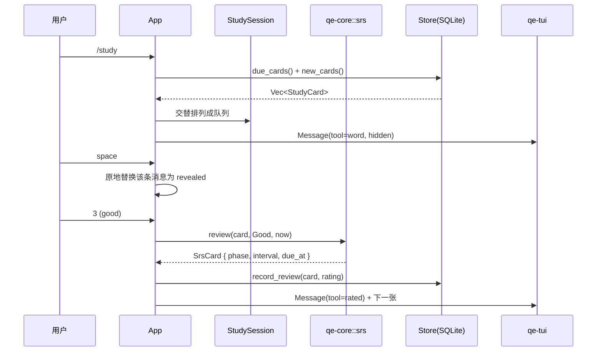

# 架构说明

## 分层

```
┌───────────────────────────────────────────────┐
│ qe-app (binary: quietly)                      │
│   main.rs   参数解析 / 子命令                  │
│   app.rs    App 状态机，事件 → 命令 → 消息      │
│   command.rs  slash 命令解析                   │
│   editor.rs   单行编辑器 / 历史                │
│   session.rs  一次学习会话                     │
│   cli.rs      一次性命令的输出格式             │
└──────────┬───────────────┬────────────────────┘
           │               │
   ┌───────▼──────┐  ┌─────▼────────┐
   │ qe-store     │  │ qe-tui       │
   │ SQLite 实现  │  │ ratatui 渲染 │
   │ 词库导入     │  │ 换行 / 配色  │
   └───────┬──────┘  └─────┬────────┘
           └───────┬───────┘
             ┌─────▼─────┐
             │ qe-core   │
             │ 模型 / SRS │
             │ 词缀 / 视图│
             └───────────┘
```

依赖只有向下：`qe-store` 和 `qe-tui` 互不依赖，`qe-app` 是唯一把它们串起来的地方。

## 一次“学一张卡”的数据流



要点：

- **揭晓是原地替换消息**，不是追加，所以对话不会刷屏；
- **评分是纯函数**：同样的 `(SrsCard, Rating, now)` 一定得到同样结果，方便测试与回放；
- **TUI 不参与决策**，只接收 `Message` 列表和光标位置。

## 消息与渲染模型

`qe_core::view` 是应用层和终端层之间的契约：

| 类型 | 用途 |
| --- | --- |
| `Message{role, body}` | 一条对话消息，`role` 只有 user/agent/system 三种 |
| `Body::Text` | 普通文本，首行带 `›` / `⏺` / 两个空格前缀 |
| `Body::Tool(ToolView)` | agent 工具块：`⏺ 名称 徽标` + `⎿ 结果` + 缩进细节 |
| `Body::Table(TableView)` | 列表输出，宽度不够时按列收缩 |
| `ToolLine` | 细节行的原子类型：文本、灰色说明、键值、进度条、例句 |

渲染侧只有 `lines.rs` 知道如何把 `ToolLine` 变成 `ratatui::Line`，
所以想换配色或改成 Markdown 输出，只需要改这一个文件。

## 数据模型

数据分两个 SQLite 文件，打开时用 `ATTACH DATABASE ... AS dict` 挂在一起，
所以跨库 JOIN 和事务都照常可用。

**`quietly.db`**（学习数据，几 MB，可进 git）

```sql
books(id, slug UNIQUE, name, description, builtin)
book_words(book_id, lemma, rank)            -- 词书内容与顺序
cards(lemma PK, book_id, phase, step, ease, interval_days,
      reps, lapses, due_at, last_review_at) -- 每词一张卡
reviews(id, lemma, at, day, rating, phase_after, interval_after, is_new)
sessions(id, day, started_at, ended_at, seconds, new_count, review_count)
settings(key, value)
texts(id, title UNIQUE, source, license, book_slug, rank, body, translation, created_at)
text_books(id, slug UNIQUE, name, source, created_at)   -- 阅读书：同源的多篇归一
reading_progress(text_id PK, paragraph, mode, updated_at)
reading_log(id, text_id, day, started_at, ended_at, seconds, paragraphs, ...)
reading_marks(text_id, lemma, paragraph, created_at)
quizzes(id, text_id, paragraph, prompt, answer, choices, source, created_at)
quiz_attempts(id, quiz_id, day, at, correct)
```

**`quietly-words.db`**（词典，500 MB+，随时重建）

```sql
words(id, lemma UNIQUE NOCASE, phonetic, translation, definition,
      roots JSON, examples JSON, tags JSON, source,
      collocations JSON, glosses JSON)
```

- `roots` / `examples` / `tags` / `collocations` / `glosses` 用 JSON 存，避免过早拆表；
  解析失败时静默降级为空。
- `cards` 以 `lemma` 为主键：一个词只有一份记忆状态，多个词书共享。
- `reviews` 是流水，`daily` / `streak` / `due` 全部从它和 `cards` 派生，没有冗余计数器。
- **跨库外键在 SQLite 里不生效**，所以 `book_words` / `cards` / `reviews` 用 `lemma`
  而不是 `words.id` 做跨库键。词典库的 `id` 是 AUTOINCREMENT，换一份词典或换导入顺序
  就会变；存 id 时词书会静默指向别的词（原来的 `alpha` 变成 `gamma`）。`lemma` 在两个
  库里都唯一，换词典后依然指向同一个词。
- 引用是否完整由 `quietly doctor` 核对；`--fix` 清掉词典里已经不存在的词。词典库是空的
  时 `--fix` 不会动手，免得一次误操作把全部进度删光。

## 记忆曲线

`crates/qe-core/src/srs.rs`，Anki 风格：

| 阶段 | 行为 |
| --- | --- |
| New | 认识 → 学习步骤 2（1 天）；简单 → 直接毕业 5 天；忘记/模糊 → 10 分钟后重来 |
| Learning | 逐步走完 `10min → 1d`，走完即毕业 |
| Review | 间隔 × ease；`Hard` 只 ×1.2 且降 ease，`Easy` 额外 ×1.3 |
| Relearning | 遗忘后间隔减半，回到 10 分钟重学，`Good` 后回 Review |

约束：`ease ∈ [1.3, 3.0]`，`interval ∈ [1, 365]` 天。

## 扩展阅读 / 翻译 / 写作

新增一个模块通常只碰四个位置：

1. `qe-core/src/<module>.rs`：纯逻辑与视图构造（例如 `reading::paragraph_view`）；
2. `qe-store`：新增表或复用 `words`，实现新的查询方法；
3. `qe-app`：加一个 `Command` 变体和 `App::<action>`；
4. `qe-tui`：只有在需要新的排版元素时才改（例如内联高亮、输入多行）。

命令解析与执行已经分离，界面层也只认识 `Message`，所以三个后续模块可以和单词模块并行开发。

## 测试策略

- `qe-core`：SRS 边界（夹紧、上限、遗忘后回调）、词缀拆词、换行
- `qe-store`：导入 → 学习 → 统计的端到端流程（临时 SQLite 文件）
- `qe-app`：命令解析、编辑器历史
- `qe-tui`：`Message` → 文本行快照（验证 `⏺`/`⎿` 布局与宽度约束）
